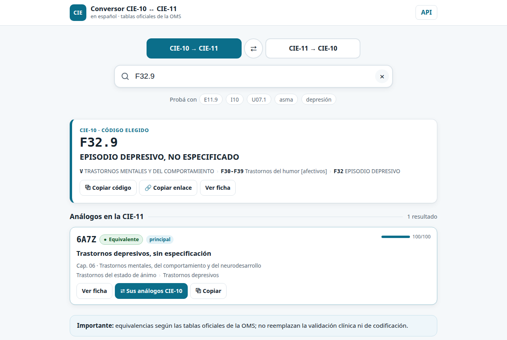

# ICD-10 ↔ ICD-11 converter (Spanish)

**Convert ICD-10 codes to ICD-11 and back using the official WHO mapping tables, with Spanish titles.** A search microsite plus a REST API, with no third-party browser dependencies, that runs on a Python server or on any shared hosting with PHP.

[Versión en español](README.md) · **Live demo: [hiox.com.ar/cie](https://hiox.com.ar/cie/)** · [Live API](https://hiox.com.ar/cie/api/) · [API docs](https://hiox.com.ar/cie/api/docs/)



> The user interface, API field names and data are in Spanish (CIE = *Clasificación Internacional de Enfermedades*, the Spanish name of the ICD). The code is small and readable if you want to adapt it to another language edition.

## Features

- **Both directions** (ICD-10 → ICD-11 and ICD-11 → ICD-10) using the **official WHO mapping tables** of the MMS 2026-01 release, with every mapping labelled: *equivalent*, *approximate*, *one-to-many*, *combination* (postcoordinated clusters such as `1A00&XN8P1`), *grouping*, *related* or *no equivalent*.
- **Search by code or by word**, accent- and case-insensitive, with **typo correction** ("diabetis" → "diabetes").
- **Chapter, block and the full hierarchy path** for every code, its children, and a link to the official WHO browser.
- **Inheritance**: when the table does not list a subcategory (e.g. the 4th-character place codes in W00-Y34), the parent category's mapping is shown and flagged as such.
- When there is no official mapping, **text-based suggestions are shown separately and labelled "NOT OFFICIAL"**.
- **REST API** (`/api/v1`) with OpenAPI 3, batch conversion (up to 100 codes), CORS, ETags and interactive docs.
- **White label**: name, tagline, colours and footer come from one JSON file (`marca.json`).
- Accessible (ARIA combobox, fully keyboard-operable), mobile-friendly, no cookies, no analytics, no CDN.

**Data (downloaded by the ETL):** ICD-11 MMS 2026-01 in Spanish (37,052 entities), ICD-10 in Spanish (14,670 codes, including WHO updates up to 2021 such as COVID-19), and the WHO 10→11 and 11→10 tables. 99.7 % of ICD-10 codes have an ICD-11 counterpart; 17,234 of 17,255 ICD-11 codes in chapters 01-25 have an ICD-10 counterpart.

## API example

```bash
curl -s https://hiox.com.ar/cie/api/v1/convertir/cie10-a-cie11/E11.9
```

| Purpose | Route |
|---|---|
| ICD-11 counterparts of an ICD-10 code | `GET /api/v1/convertir/cie10-a-cie11/{code}` |
| ICD-10 counterparts of an ICD-11 code | `GET /api/v1/convertir/cie11-a-cie10/{code}` |
| Batch (up to 100) | `POST /api/v1/convertir/lote` with `{"sentido": "cie10-a-cie11", "codigos": ["E11.9", "I10"]}` |
| Search by code or text | `GET /api/v1/cie10/buscar?q=asma` · `GET /api/v1/cie11/buscar?q=asma` |
| Entity, children, ancestors | `GET /api/v1/cie10/{code}` · `…/hijos` · `…/ancestros` (same for `cie11`) |
| Chapters | `GET /api/v1/cie10/capitulos` · `GET /api/v1/cie11/capitulos` |
| Versions, sources, licences | `GET /api/v1/meta` |
| Health / spec | `GET /api/v1/salud` · `GET /api/v1/openapi.json` |

ICD-11 ids that contain a slash (`761947693/unspecified`) go with the literal slash. The public demo is meant for lookups and testing; its host has bot protection that may throttle bursts. To integrate a system, run your own copy.

## Running it

Requires Python 3.10+ and, for the ETL, `pdftotext` (poppler-utils).

```bash
git clone https://github.com/DasLatam/icd10-icd11-converter-es.git
cd icd10-icd11-converter-es
pip install flask                      # the only dependency
python3 scripts/etl.py                 # downloads the official sources and builds storage/cie.db (~1 min)
python3 serve.py 8000                  # microsite + API at http://localhost:8000
```

**Shared hosting with PHP (no Python on the server):** `python3 scripts/construir_estatico.py --destino dist --url-publica https://your-site.org/cie`, then upload `dist/` to any folder (Apache + PHP ≥ 7.4 with `pdo_sqlite`; SQLite ≥ 3.9 with FTS5). The PHP API (`php/index.php`) is a field-by-field port of the Python one, and `tests/paridad_php.py` checks that both return identical responses. Local test: `php -S 127.0.0.1:8000 -t dist dist/router.php`. The Python server adds per-IP rate limiting and optional API keys (`scripts/claves.py`).

**Tests:** `python3 -m unittest -v tests.test_api` · `python3 tests/paridad_php.py` · `python3 scripts/probar_navegador.py` (Playwright) · `python3 scripts/carga.py` (load).

## Rebranding

Edit [`marca.json`](marca.json) (or point the `CIE_MARCA` environment variable to another file): `nombre` (name), `lema` (tagline), `logo` (badge text), `descripcion` (meta description), `url_publica` (canonical URL), `indexar` (allow search engines), `pie_html` (extra footer line) and `colores` (accent, light accent, background, text, focus). Restart `serve.py` or rebuild with `construir_estatico.py`. **The WHO and source attribution in the footer is intentionally not configurable**: the ICD-11 licence requires it.

## Licences and attribution

**Code:** [MIT](LICENSE). **Data is not included in this repository**: `scripts/etl.py` downloads it from the official sources and records hash and date for each file.

- **ICD-11 MMS and the WHO mapping tables:** © WHO, [CC BY-ND 3.0 IGO](https://creativecommons.org/licenses/by-nd/3.0/igo/) plus the [WHO Classifications terms of use](https://icd.who.int/en/docs/icd11-license.pdf). Incorporating them in software and showing or redistributing them is allowed **unmodified, with attribution, code, title and URI** (§1.2.2-1.2.3). Translations and home-made crosswalks require a WHO agreement (§1.2.4); added fields must be labelled as non-WHO (§1.2.5). This project only uses WHO's own tables, shows titles as published, and labels its additions (mapping *type*, ordering *score*, parent *inheritance*, text *suggestions*) as not originating from WHO.
- **ICD-10 in Spanish:** © WHO; Spanish edition by PAHO. Source: the `CATCIE10.csv` catalogue published as open data by Mexico's Ministry of Health (DGIS, maintained with CEMECE, a WHO/PAHO collaborating centre), under Mexico's open data terms (Libre Uso MX). Block titles are extracted from PAHO's ICD-10 Volume 1 (2018); the PDF itself is not redistributed.
- Required ICD-11 citation: *International Classification of Diseases, Eleventh Revision (ICD-11), World Health Organization (WHO) 2019 https://icd.who.int/browse11. Licensed under the Creative Commons Attribution-NoDerivatives 3.0 IGO licence (CC BY-ND 3.0 IGO).*

This project is not affiliated with or endorsed by WHO, PAHO or Mexico's Ministry of Health. **The mappings do not replace clinical or coding review.**

## Contributing

Issues and pull requests are welcome. Run `python3 -m unittest tests.test_api` before sending a change and, if you touch the API, `python3 tests/paridad_php.py` (both implementations must answer the same). Corrections to **titles or mappings** belong to WHO and are proposed on the [ICD-11 maintenance platform](https://icd.who.int/dev11).
