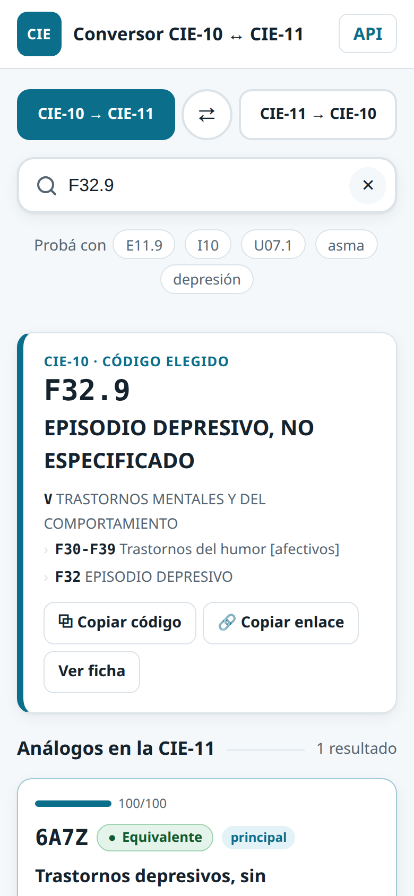

# Conversor CIE-10 ↔ CIE-11 en español

**Pasá códigos de la CIE-10 a la CIE-11 y al revés, con las tablas oficiales de correspondencia de la OMS.** Micrositio de búsqueda + API REST, en español, sin dependencias de terceros en el navegador, que corre en un servidor Python o en cualquier hosting compartido con PHP.

[English version](README.en.md) · **Demo en vivo: [hiox.com.ar/cie](https://hiox.com.ar/cie/)** · [API en vivo](https://hiox.com.ar/cie/api/) · [Documentación de la API](https://hiox.com.ar/cie/api/docs/)


## Qué hace

- **Convierte en los dos sentidos** (CIE-10 → CIE-11 y CIE-11 → CIE-10) con las **tablas oficiales de la OMS** de la versión MMS 2026-01, y rotula cada correspondencia: *equivalente*, *aproximado*, *uno a varios*, *combinación* (clústeres postcoordinados como `1A00&XN8P1`), *agrupación*, *relacionado* o *sin equivalente*.
- **Busca por código o por palabra**, sin importar tildes ni mayúsculas, y **corrige errores de tipeo** («diabetis» → «diabetes», «nemonia» → «neumonía»).
- Muestra **capítulo, grupo/bloque y la ruta jerárquica completa**, los hijos de cada código, y enlaza la ficha oficial de la OMS.
- **Hereda** la correspondencia de la categoría madre cuando la tabla no trae la subcategoría (p. ej. el 4.º carácter de lugar en W00-Y34), y lo avisa.
- Cuando no hay equivalencia oficial, ofrece **sugerencias por texto separadas y rotuladas «NO OFICIAL»**.
- **API REST** (`/api/v1`) con OpenAPI 3, conversión por lote (hasta 100 códigos), CORS, ETag y documentación con botón «Probar».
- **Marca blanca**: nombre, lema, colores y pie salen de un JSON (`marca.json`).
- Accesible (combobox ARIA, se usa entero con teclado), funciona en el celular y no usa cookies, ni analítica, ni CDN.

| | |
|---|---|
|  | **Datos incluidos (los baja el ETL):**<br>• CIE-11 MMS 2026-01 en español: 37.052 entidades<br>• CIE-10 en español: 14.670 códigos (con las actualizaciones de la OMS hasta 2021, COVID-19 incluido)<br>• Tablas de correspondencia OMS 10→11 y 11→10<br><br>**Cobertura:** 99,7 % de los códigos CIE-10 tienen análogo CIE-11; 17.234 de 17.255 códigos CIE-11 (capítulos 01-25) tienen análogo CIE-10. |

## Para quién

Codificadores, médicos, áreas de estadística y equipos de sistemas de salud (historia clínica, facturación, vigilancia epidemiológica) que tienen que pasar de la CIE-10 a la CIE-11 en español.

**Qué entra:** CIE-10 y CIE-11 en español, las tablas oficiales de la OMS, búsqueda, jerarquía, conversión por lote y API.
**Qué queda afuera:** correspondencias propias (sólo las de la OMS), traducciones o reescrituras de títulos, las modificaciones nacionales CIE-10-CM / CIE-10-ES, la postcoordinación libre de la CIE-11 y cualquier dato de pacientes (no se reciben ni se guardan).

**Estado:** estable. Publicado en [hiox.com.ar/cie](https://hiox.com.ar/cie/) con la versión PHP. 32 pruebas de la API, prueba de paridad PHP ↔ Python (77 pedidos idénticos), prueba en navegador real (escritorio y celular) y de carga (100 clientes simultáneos, 0 errores).

## Ejemplo de API

```bash
curl -s https://hiox.com.ar/cie/api/v1/convertir/cie10-a-cie11/E11.9
```

```json
{
  "sentido": "cie10-a-cie11",
  "origen": { "codigo": "E11.9", "titulo": "DIABETES MELLITUS TIPO 2, SIN MENCIÓN DE COMPLICACIÓN", "...": "..." },
  "equivalencias": [
    {
      "codigo": "5A11",
      "titulo": "Diabetes mellitus tipo 2",
      "uri": "http://id.who.int/icd/release/11/mms/119724091",
      "correspondencia": { "tipo": "aproximado", "rotulo": "Aproximado", "principal": true, "puntaje": 75, "...": "..." }
    }
  ],
  "total": 1,
  "aviso": "Equivalencias según las tablas oficiales de la OMS; no reemplazan la validación clínica ni de codificación."
}
```

| Para | Ruta |
|---|---|
| Análogos CIE-11 de un código CIE-10 | `GET /api/v1/convertir/cie10-a-cie11/{codigo}` |
| Análogos CIE-10 de un código CIE-11 | `GET /api/v1/convertir/cie11-a-cie10/{codigo}` |
| Conversión por lote (hasta 100) | `POST /api/v1/convertir/lote` con `{"sentido": "cie10-a-cie11", "codigos": ["E11.9", "I10"]}` |
| Buscar por código o texto | `GET /api/v1/cie10/buscar?q=asma` · `GET /api/v1/cie11/buscar?q=asma` |
| Ficha, hijos y ancestros | `GET /api/v1/cie10/{codigo}` · `…/hijos` · `…/ancestros` (ídem `cie11`) |
| Capítulos | `GET /api/v1/cie10/capitulos` · `GET /api/v1/cie11/capitulos` |
| Versiones, fuentes y licencias | `GET /api/v1/meta` |
| Estado | `GET /api/v1/salud` |
| Especificación | `GET /api/v1/openapi.json` |

Los id de la CIE-11 que llevan barra (`761947693/unspecified`) van con la barra tal cual: `/api/v1/cie11/761947693/unspecified`.
La demo pública es para consulta y pruebas: el hosting tiene protección anti-robots y puede frenar ráfagas. Para integrar un sistema, levantá tu propia copia (es un comando).

## Cómo correrlo

Necesita Python 3.10+ y, para el ETL, `pdftotext` (poppler-utils).

```bash
git clone https://github.com/DasLatam/icd10-icd11-converter-es.git
cd icd10-icd11-converter-es
pip install flask                      # la única dependencia
python3 scripts/etl.py                 # baja las fuentes oficiales y arma storage/cie.db (~1 min)
python3 serve.py 8000                  # micrositio + API en http://localhost:8000
```

### En un hosting compartido con PHP (sin Python en el servidor)

```bash
python3 scripts/construir_estatico.py --destino dist --url-publica https://tu-sitio.org/cie
```

Subí el contenido de `dist/` a cualquier carpeta del hosting (Apache + PHP ≥ 7.4 con `pdo_sqlite`; SQLite ≥ 3.9 con FTS5). La API PHP (`php/index.php`) es un port de la de Python, campo por campo. Para probarla en local: `php -S 127.0.0.1:8000 -t dist dist/router.php`.

La versión PHP no lleva límite de pedidos ni claves de API (en un hosting compartido no hay memoria entre pedidos); el servidor Python sí: límite por IP, claves opcionales (`scripts/claves.py`) y `storage/config.json` (CORS, tope del lote, proxies de confianza).

### Pruebas

```bash
python3 -m unittest -v tests.test_api      # API: conversiones conocidas, búsqueda, errores, ETag, CORS, límites
python3 tests/paridad_php.py               # API PHP == API Python (necesita php en el PATH)
python3 scripts/probar_navegador.py        # Playwright, escritorio y celular, sin errores de consola
python3 scripts/carga.py                   # 100 clientes simultáneos
```

## Cambiarle la marca

Todo lo que se ve sale de [`marca.json`](marca.json) (o del archivo que diga la variable `CIE_MARCA`):

```json
{
  "nombre": "Conversor CIE de mi hospital",
  "lema": "Servicio de Estadística",
  "logo": "HSJ",
  "descripcion": "Texto para buscadores y redes.",
  "url_publica": "https://ejemplo.org/cie",
  "indexar": true,
  "pie_html": "Un servicio de <a href=\"https://ejemplo.org\">Hospital San José</a>",
  "colores": { "acento": "#7a1f5c", "acento_claro": "#f6e8f1", "fondo": "#faf7f9", "tinta": "#1d1220", "foco": "#e0a100" }
}
```

Reiniciá `serve.py` (o volvé a correr `construir_estatico.py`). Los colores van a `marca.css`; la Content-Security-Policy no admite estilos en línea, así que no hace falta tocar HTML ni CSS. **La atribución de la OMS y de las fuentes del pie no es configurable a propósito**: la licencia de la CIE-11 exige mantenerla (ver abajo).

## Fuentes, licencias y atribución

**Código:** [MIT](LICENSE).

**Datos:** el repositorio **no incluye datos**; `scripts/etl.py` los baja de las fuentes oficiales y deja hash y fecha de cada archivo en `storage/fuentes/INDICE.md`.

| Datos | Fuente | Licencia y condiciones |
|---|---|---|
| CIE-11 MMS 2026-01 en español | OMS, [`SimpleTabulation-ICD-11-MMS-es.zip`](https://icd.who.int/browse/2026-01/mms/es) (descarga abierta) | [CC BY-ND 3.0 IGO](https://creativecommons.org/licenses/by-nd/3.0/igo/) y [términos de uso de las Clasificaciones](https://icd.who.int/en/docs/icd11-license.pdf). Se puede incorporar en software y mostrar o redistribuir **sin modificar y con atribución, código, título y URI** (§1.2.2-1.2.3). No se pueden traducir ni crear correspondencias propias sin acuerdo de la OMS (§1.2.4); los campos agregados tienen que rotularse como no-OMS (§1.2.5). |
| Tablas de correspondencia CIE-10 ↔ CIE-11 | OMS, [`mapping.zip`](https://icdcdn.who.int/static/releasefiles/2026-01/mapping.zip) de la misma versión | Mismas condiciones. Se usan tal cual (sólo códigos y URI; los títulos salen de las clasificaciones en español). |
| CIE-10 en español | Secretaría de Salud de México, DGIS, `CATCIE10.csv` de los [catálogos de egresos hospitalarios](http://www.dgis.salud.gob.mx/contenidos/basesdedatos/da_egresoshosp_gobmx.html) (datos abiertos, mantenido con el CEMECE, centro colaborador de la OMS/OPS) | La CIE-10 es © OMS; la edición en español, de la OPS. El catálogo se publica como dato abierto del Gobierno de México (Términos de Libre Uso MX): uso y redistribución con atribución. |
| Títulos de grupo CIE-10 | OPS/OMS, CIE-10 Vol. 1, edición 2018 (lista de tres caracteres) | Sólo se extraen los 266 títulos de grupo; el PDF no se redistribuye. |

**Qué es de este proyecto y no de la OMS** (rotulado así en la API, como pide §1.2.5): el *tipo* de correspondencia (equivalente, aproximado…), el *puntaje* de orden, la *herencia* de la categoría madre y las *sugerencias automáticas* por texto. Las sugerencias no se guardan como tabla: son una búsqueda en vivo, separada y marcada «NO OFICIAL».

Cita requerida para la CIE-11: *Clasificación Internacional de Enfermedades, Undécima Revisión (CIE-11), Organización Mundial de la Salud (OMS) 2019 https://icd.who.int/browse11. Bajo licencia Creative Commons Atribución-SinDerivadas 3.0 IGO (CC BY-ND 3.0 IGO).*

Este proyecto no es de la OMS, la OPS ni la Secretaría de Salud de México, ni está avalado por ellas. **Las equivalencias no reemplazan la validación clínica ni de codificación.**

## Cómo está hecho

```
app/            API Flask (api.py), consultas a SQLite (datos.py), marca (marca.py), openapi.json
php/            la misma API en PHP + .htaccess + router para `php -S`
micrositio/     HTML, CSS y JS sin dependencias ni pasos de build
scripts/        etl.py (fuentes → storage/cie.db), construir_estatico.py, openapi.py, claves.py, carga.py...
tests/          test_api.py, paridad_php.py
marca.json      la marca blanca
```

- **SQLite de sólo lectura** (`immutable=1`) con FTS5 (`unicode61 remove_diacritics 1`) sobre código + título normalizado; la corrección de tipeo compara cada palabra con el vocabulario de títulos (`difflib`, mismo algoritmo en PHP).
- **Seguridad:** consultas parametrizadas, CSP estricta (`script-src 'self'`, sin estilos en línea), el lote sólo acepta códigos y rechaza cualquier otro campo, sin registro del contenido de las consultas (sólo contadores agregados por ruta y día en el servidor Python).
- **Versión nueva de la CIE-11** (la OMS publica dos por año): cambiar `VERSION_CIE11` en `scripts/etl.py` y `NAVEGADOR_OMS` en `app/datos.py`, correr `scripts/etl.py --bajar` y las pruebas.

## Contribuir

Issues y pull requests bienvenidos. Antes de mandar un cambio: `python3 -m unittest tests.test_api` y, si tocás la API, `python3 tests/paridad_php.py` (las dos versiones tienen que responder lo mismo). Correcciones a los **títulos o a las correspondencias** no van acá: son de la OMS y se proponen en la [plataforma de mantenimiento de la CIE-11](https://icd.who.int/dev11).
